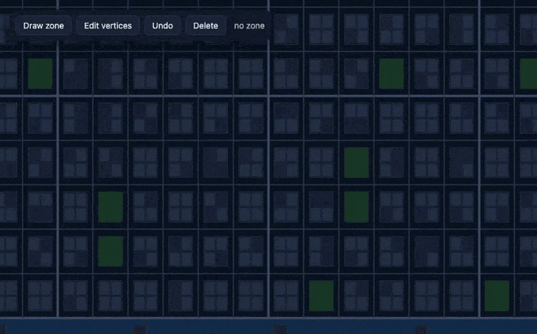

<div align="center">
  <picture>
    <source media="(prefers-color-scheme: dark)" srcset="https://raw.githubusercontent.com/Ridewolf/maplibre-zone-editor/main/docs/logo-white.png">
    
  </picture>
  <h1>@ridewolf/maplibre-zone-editor</h1>
  <p>A headless polygon zone editor for MapLibre GL.<br>
  Draw/edit modes, an undo stack, double-tap vertex deletion with a triangle<br>
  guard, and clean geometry events — bring your own buttons.</p>
</div>

<p align="center">
  <a href="https://github.com/Ridewolf/maplibre-zone-editor/actions/workflows/ci.yml"></a>
  <a href="https://www.npmjs.com/package/@ridewolf/maplibre-zone-editor"></a>
  
  
  
  <a href="LICENSE"></a>
</p>

---

<!-- docs-i18n:switcher -->
<p align="center"><sub><b>English</b> · <a href="docs/i18n/ru/README.md">Русский</a> · <a href="docs/i18n/ro/README.md">Română</a> · <a href="docs/i18n/de/README.md">Deutsch</a> · <a href="docs/i18n/es/README.md">Español</a> · <a href="docs/i18n/fr/README.md">Français</a> · <a href="docs/i18n/it/README.md">Italiano</a> · <a href="docs/i18n/pt/README.md">Português</a> · <a href="docs/i18n/uk/README.md">Українська</a> · <a href="docs/i18n/pl/README.md">Polski</a> · <a href="docs/i18n/tr/README.md">Türkçe</a> · <a href="docs/i18n/sv/README.md">Svenska</a> · <a href="docs/i18n/nl/README.md">Nederlands</a> · <a href="docs/i18n/el/README.md">Ελληνικά</a> · <a href="docs/i18n/ar/README.md">العربية</a> · <a href="docs/i18n/he/README.md">עברית</a></sub></p>
<!-- /docs-i18n:switcher -->

<p align="center">
  
</p>

Building a geofence editor on MapLibre means gluing `mapbox-gl-draw` onto a library it
wasn't written for, styling its internals, inventing undo, and teaching mobile users to
edit vertices. Every mobility dashboard does this from scratch. This package is that
glue, extracted from the Ridewolf zone editor — headless, so it renders zero UI and
works with any framework's buttons.

## Quickstart

```bash
bun add @ridewolf/maplibre-zone-editor maplibre-gl @mapbox/mapbox-gl-draw
```

```ts
import MapboxDraw from '@mapbox/mapbox-gl-draw';
import { Map as MapLibreMap } from 'maplibre-gl';
import { createZoneEditor } from '@ridewolf/maplibre-zone-editor';
import '@mapbox/mapbox-gl-draw/dist/mapbox-gl-draw.css';

const map = new MapLibreMap({ container: 'map', style: STYLE_URL });

const editor = createZoneEditor(map, MapboxDraw, {
  color: '#3B82F6',
  onChange: (polygon) => save(polygon), // GeoJSON Polygon | null
  onInvalidAction: (reason) => toast(reason), // 'no-polygon' | 'min-vertices'
});
editor.attach();

// Wire your own toolbar:
drawButton.onclick = () => editor.startDrawing();
editButton.onclick = () => editor.startEditing();
undoButton.onclick = () => editor.undo();
deleteButton.onclick = () => editor.deletePolygon();
```

Or run the bundled demo — the toolbar above, on a map that needs no tile server or
API key (the basemap is generated as GeoJSON):

```bash
bun install && bun run build && bunx serve .   # → examples/demo.html
```

## What it handles for you

- **The MapLibre compatibility patch** — `mapbox-gl-draw` targets Mapbox GL's DOM class
  names and silently misbehaves on MapLibre; `patchMapboxDrawForMapLibre()` rewrites
  them (applied automatically by the editor).
- **Undo** — every create/update/delete snapshots the draw state (bounded depth,
  default 20); `undo()` walks back through it down to an empty canvas.
- **Double-click / double-tap vertex deletion** — with a finger-friendly hit box, the
  default dblclick-zoom swallowed, and a **triangle guard**: a deletion that would
  leave fewer than three corners is refused (reported via `onInvalidAction`) instead
  of producing invalid geometry.
- **Clean geometry events** — `onChange` fires with a plain GeoJSON `Polygon` (or
  `null`), not draw's internal feature collection.
- **Touch-tuned draw styles** — translucent fill, 6.5 px vertex handles, subtle
  midpoints, all in your accent colour (`buildDrawStyles(color)` is exported for
  customization).
- **Injected dependencies** — the `MapboxDraw` constructor is a parameter, so forks
  work and the whole editor is testable without a browser (see the fake-driven
  [test suite](src/editor.test.ts)).

## API

| Member | Purpose |
| --- | --- |
| `createZoneEditor(map, MapboxDraw, options)` | Construct; `attach()` / `detach()` manage map bindings. |
| `startDrawing()` | Enter polygon-drawing mode. |
| `startEditing()` | Enter vertex-editing mode on the drawn polygon. |
| `deletePolygon()` | Remove the polygon (undoable). |
| `undo()` | Step back through the snapshot stack. |
| `getGeometry()` / `setGeometry(polygon \| null)` | GeoJSON in, GeoJSON out. `setGeometry` resets the undo stack and does not fire `onChange`. |

Options: `color`, `onChange`, `onInvalidAction`, `maxUndoStates`, `vertexHitTolerance`.

## Documentation

- [Design notes](docs/design.md) — why headless, the vertex-deletion mechanics, the
  single-polygon model, and integration recipes (Vue/React).

## Why we built this

At [Ridewolf](https://ridewolf.com) operators draw geofence zones — parking, no-go,
speed-limited — directly on the dashboard map. The editor behind that went through the
usual pain: draw misbehaving on MapLibre, accidental vertex loss producing degenerate
polygons the backend rejected, and mobile operators unable to delete vertices at all.
This package is the survivor, minus our UI.

## Contributing

Contributions welcome — see the [contributing guide](https://github.com/Ridewolf/.github/blob/main/CONTRIBUTING.md).
Run `bun test`, `bun run lint`, `bun run typecheck` before a PR. Security issues:
[SECURITY.md](https://github.com/Ridewolf/.github/blob/main/SECURITY.md) — never in a public issue.

## License

[Apache-2.0](LICENSE) © [Ridewolf](https://ridewolf.com)
